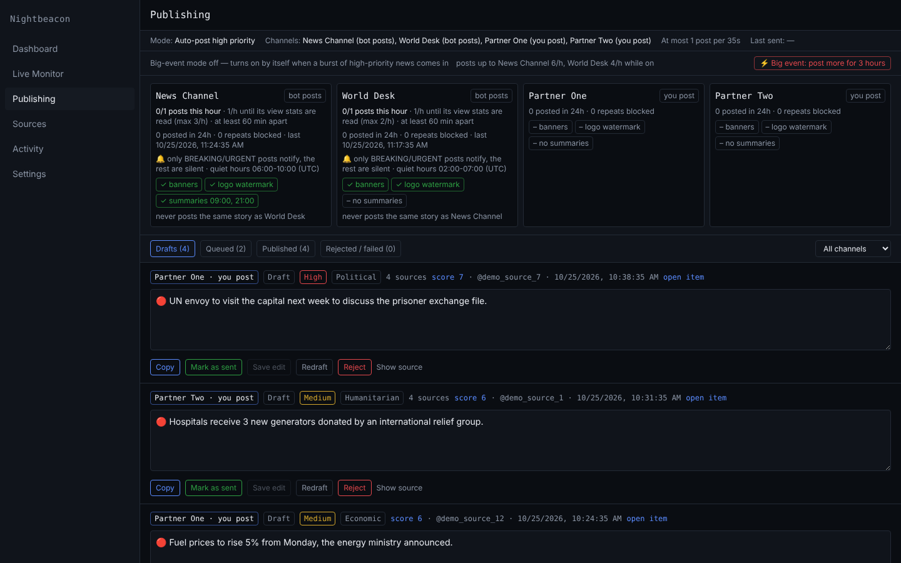
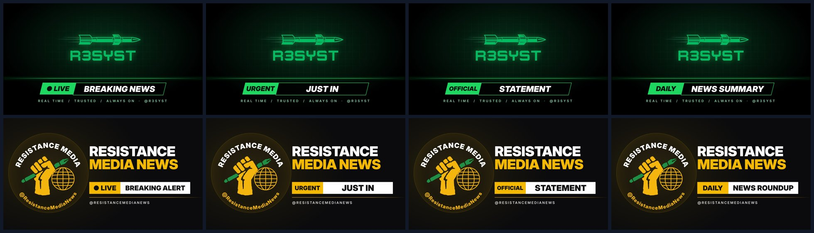
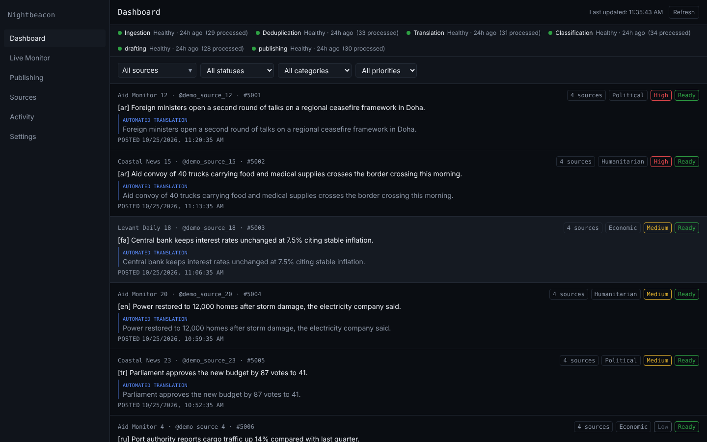
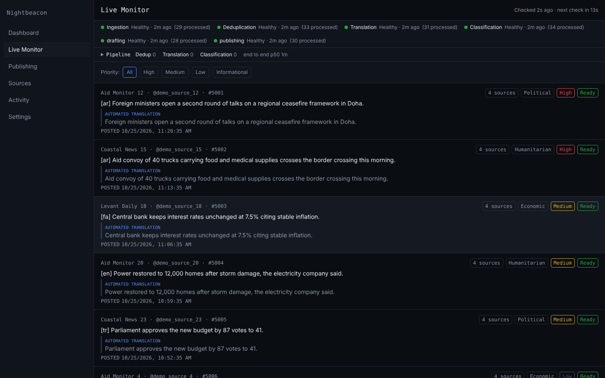
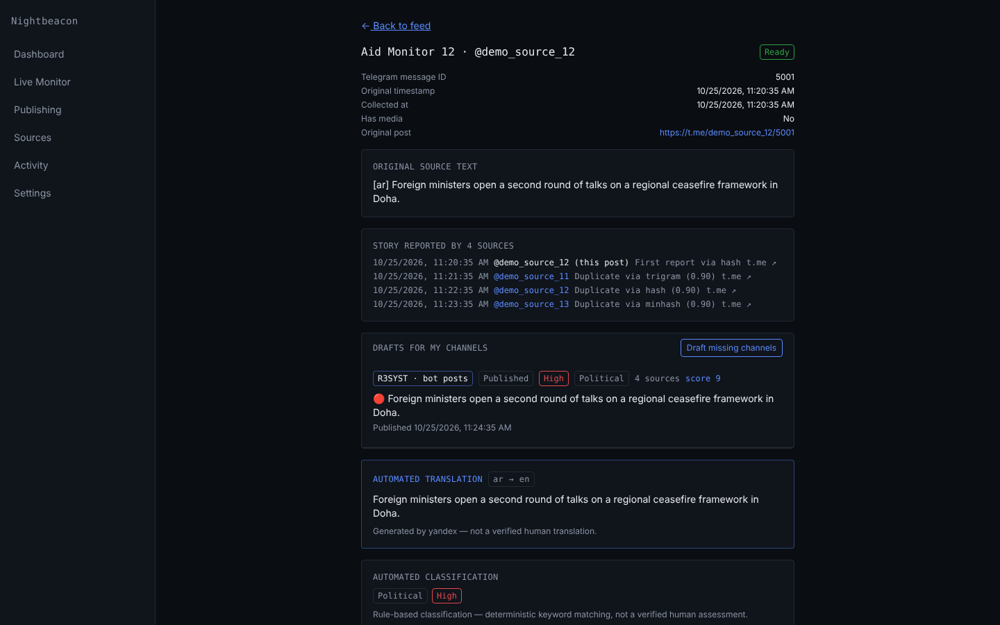
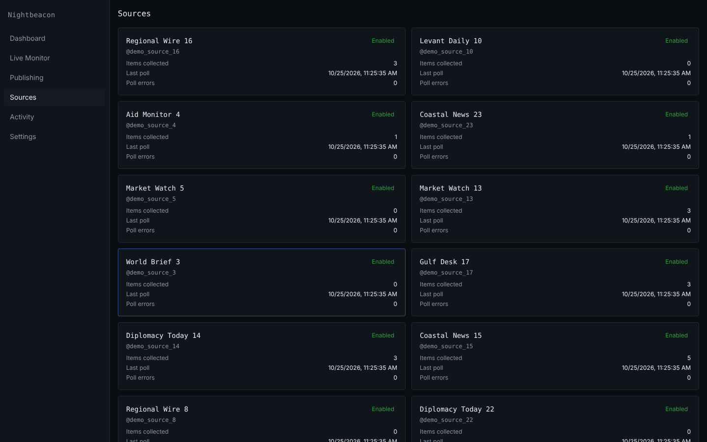
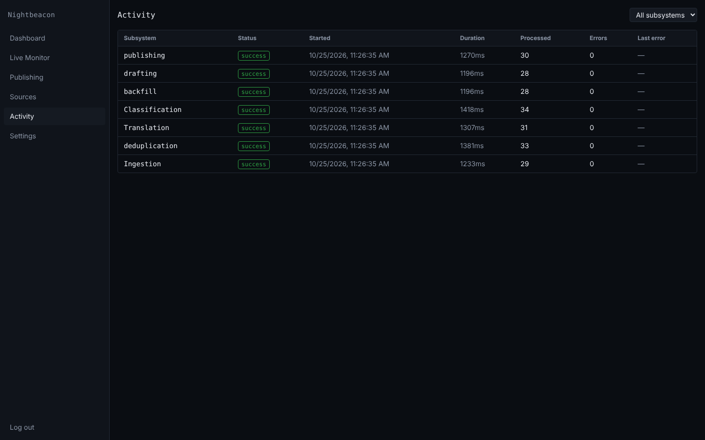

# Nightbeacon

A single-operator Telegram news pipeline: it monitors ~1000 public Telegram
channels, removes duplicates, translates everything to English for free,
scores the stories, and drafts posts in the style of each of your own
channels — posting automatically to the channel its bot admins and preparing
ready-to-copy drafts for the rest.



- [How it works](#how-it-works) · [Publishing](#publishing) ·
  [Screenshots](#screenshots) · [Running it](#running-it-windows) ·
  [Commands](#useful-commands) · [Security](#security)

## How it works

```
~1000 source channels ─► poll ─► dedup ─► priority guess ─► translate ─► classify
                                            (below bar: feed only)          │
          your channels ◄── bot posts / manual drafts ◄── score + draft
```

1. **Ingestion** — GramJS (MTProto, through MTProxies with automatic
   failover) polls the
   sources with flood-wait-safe pacing, backfills gaps and receives push
   updates for joined channels. A newly added source only contributes its
   last hour, so additions don't flood the queue.
   Every 10 minutes the proxies are speed-tested: the connection moves to a
   clearly faster one, and when fewer than 3 answer, new links are fetched
   from @mtpro_xyz_bot (`PROXY_BOT`) and saved to `server/proxies-found.txt`.
2. **Dedup before translation** — exact hash, in-memory MinHash (catches
   relays that add their own header/footer), trigram and optional
   cross-language semantic matching (a small multilingual model such as
   `paraphrase-multilingual` via Ollama) group relays of the same report into one *story*;
   reports that add new figures are kept as story updates.
3. **Classify first** — the original text gets a priority guess from keyword
   lists in Arabic, Persian, Russian, Ukrainian, Hebrew, Turkish, Urdu and
   English. Only posts at or above `TRANSLATE_MIN_PRIORITY` (default
   `medium`) are translated, plus English posts, official channels and stories
   3+ channels report. The rest go to the feed untranslated (`off` translates
   everything).
4. **Translation** — a rotation of free translators and LLMs (below). A
   provider that runs out of quota or misbehaves rests and the next one takes
   over, so translation (and therefore posting) never stops.
5. **Classification** — rule-based category, priority and tags.
6. **Publishing** — stories are scored, the best are drafted in each channel's
   style, and sent at a safe pace (see [Publishing](#publishing)).

## Publishing

Target channels are configured in `server/channels/channels.json`:

| Channel | Delivery | Limit | Notes |
|---|---|---|---|
| @r3syst | Bot (@Nightbeaconbot) posts high priority automatically | ~1/hour on average, re-paced weekly from last week's views, up to 3/hour | summaries at 09:00 and 21:00 · quiet hours 06:00–10:00 |
| @ResistanceMediaNews | Bot (@Nightbeaconbot) posts high priority automatically | ~1/hour on average, re-paced weekly from last week's views, up to 2/hour | quiet hours 02:00–07:00 |
| @GiviDpr, @RezistanceTrench1 | Drafts in the dashboard — Copy, then Mark as sent | 2/hour | unsent drafts expire after 6 hours |

Each channel's settings (`postsPerHour`, `maxPerHour`, `pace`, `surge`, `exclusiveGroup`,
`notify`, `quietHours`, `digest`, `banners`) are in `channels.json`; the
Publishing page shows them per channel, with posts this hour, posted in the
last 24 h and repeats blocked.

- **Selection** — score = priority × (1 + log₂ reports) × update 1.3 ×
  official source 2 × has media 1.2 × freshness. Each bot channel's hourly
  limit and minimum gap are enforced at send time (Post now and summaries
  are exempt). Stale unsent posts expire.
- **Writing rules** — facts only; neutral attribution ("CENTCOM said", "IRGC
  said"); no mention of which channels reported it; no 🇮🇱 emoji.
  Editable text files in `server/channels/`:
  - `terminology.md` — wording replacements (IDF → IOF, Houthis → Ansarallah,
    Israel → I̶s̶r̶a̶e̶l̶, …)
  - `official-sources.md` — the only channels whose statements are treated
    as official; those statements are posted word for word (translated only)
  - `house-rules.md` — extra house style (e.g. "martyred" usage)
  - `<channel>.md` — each channel's style guide
- **Media** — the source's photos/videos (whole albums) are reposted with the
  text, preferring the cleanest copy: the official channel's upload first;
  otherwise, with ffmpeg installed (`winget install Gyan.FFmpeg`), up to 4
  copies are compared (frame hashes, length, sound) and the one without a
  channel's logo is used, then the highest resolution, then the earliest. If media fails the post still goes out as text, and the
  reason is shown in the dashboard.
- **No repeats** — R3SYST and RMN share `"exclusiveGroup": "bots"`: a story
  one of them used is never picked for the other, and every finished post is
  compared with what both posted in the last 12 hours (same words, or a good
  overlap plus the same figures) before it is queued and again before it is
  sent, so the same news isn't posted twice even when two reports weren't
  matched as one story.
- **Weekly pace from the channel's own stats** — `"pace": "stats"`: once a
  week (and when the server starts without a plan) the server reads the
  channel's posts of the previous week, 1–8 days old so their views have
  settled, and works out the average views per post for each hour of the
  day. That becomes the plan for the coming week:
  - hours whose posts were seen more get more posts, hours that weren't get
    fewer, but never less than one post per two hours;
  - the day averages `postsPerHour` (1 for both bot channels) and no hour
    goes above `maxPerHour` (R3SYST 3, RMN 2);
  - hours with few posts last week lean towards the average;
  - until the first plan is read, the channel posts `postsPerHour`.

  The plan is saved in the database, so restarts don't reset it.
  `npm run publish:check` shows the plan per hour and the day it was read;
  `npm run stats:posts` shows the views behind it.
- **Big-event mode** — `"surge": { "maxPerHour": 6 }`: when something
  major breaks, R3SYST may post up to 6 an hour and RMN up to 4 (10 and 15
  minutes apart). It turns on by itself when high-priority stories in the
  last hour reach 3× last week's hourly average (and at least 12), or one
  story is reported by 40+ channels, and stays on until 2 hours after the
  last burst. On the Publishing page, **⚡ Big event: post more for 3 hours**
  turns it on by hand and **Back to normal pace** turns it off. Thresholds:
  `SURGE_RATIO`, `SURGE_MIN_STORIES`, `SURGE_STORY_REPORTS`,
  `SURGE_HOLD_HOURS` in `.env`; `npm run publish:check` shows the
  current numbers next to them.
- **Quiet delivery** — `"notify": "breaking"`: only headline posts (BREAKING,
  URGENT, 🔴…), summaries and Post now ring subscribers' phones, the rest
  arrive silently; `"quietHours": "06:00-10:00"` makes every post silent in
  the audience's night (fewer mutes and leaves).
- **Banners** — each bot channel has its own banner set built around its
  logo (`server/channels/banners/r3syst/` and `.../rmn/`: breaking, urgent,
  live, developing, statement, update, alert, summary). Re-render or change
  labels with `node tools/banners/render-logo-banners.mjs` (logos:
  `tools/banners/*-logo.png`). A source photo that is only another channel's
  generic "breaking news" card (recognised from examples in
  `server/channels/banners/known/`, or because the same picture keeps coming
  with different stories) is swapped for the matching banner; headline posts
  without media and the daily summaries get one too (`"banners"` in
  channels.json).
- **Watermark** — reposted photos and videos get the channel's logo
  (`banners/<channel>/watermark.png`), small and 70% opaque, in the corner
  with the least going on, so nothing important is covered
  (`"watermark": true`; needs ffmpeg). Skipped for media from official
  channels and for media that already carries a logo: a fixed logo over
  moving video is detected directly; for photos, channels whose videos are
  stamped, or whose photos share the same marked corner, are learned.
- **Dashboard** — score, media, edit/save, approve, reject and **Post now**
  (bypasses the hourly cap).
- **Performance** — `npm run stats:posts` reads views and shares of your own
  posts and reports what works: hour of day, media vs. text, headline style,
  length, best and weakest posts.



Drafting uses an LLM rotation across Groq, Gemini, Cerebras, Mistral,
GitHub Models, NVIDIA, SambaNova, Cohere, OpenRouter, Cloudflare, Hugging
Face, Ollama and keyless Pollinations as the last resort, and across several
models within each provider (providers without a key are skipped).
Requests are kept small: each channel's style is condensed once into a short
cached *style card* (rebuilt when its posts or rules change), and only the
English text of a report is sent, so even a local 7–8B model (`ollama`) can
draft. `DRAFT_STYLE_CARDS=off` sends example posts instead.
`npm run publish:drain` clears a queue of posts waiting to be drafted with
all of them in parallel.
See [`docs/PUBLISHING.md`](docs/PUBLISHING.md).

## Screenshots

Taken from a demo database with sample data.

| | |
|---|---|
|  **Dashboard** — every post with source, translation, category, priority and how many channels reported it |  **Live Monitor** — the newest posts as they arrive, subsystem health and pipeline backlog |
|  **Publishing** — per-channel cards, drafts, queue and published posts |  **Content inspector** — original text, every channel that relayed it, drafts, translation and classification |
|  **Sources** — monitored channels and their poll status |  **Activity** — subsystem runs and errors |

## Translation providers

Set the order with `TRANSLATION_PROVIDER` in `server/.env`, e.g.
`telegram,yandex,google,deepl,cloudflare,huggingface,mymemory,libretranslate`.

| Keyless | Need a free key/setup |
|---|---|
| telegram (your account), google, yandex, bing, lingva, mymemory | deepl, microsoft, cloudflare, huggingface, libretranslate (local), nllb (local, `tools/nllb`), LLMs (groq, gemini, cerebras, mistral, openrouter) |

Garbage output (repeated or empty translations) is rejected and retried with
another provider. `npm run translate:check` tests every provider;
`npm run translate:drain` clears an old backlog quickly by running all
providers in parallel on batches (it never uses the Telegram account).

## Running it (Windows)

See [`docs/DEVELOPMENT.md`](docs/DEVELOPMENT.md) for first-time setup.
Afterwards, double-click `start.cmd`: it starts whatever isn't already
running (local PostgreSQL on port 5434, LibreTranslate/NLLB if installed, the
server and the web app) and opens the dashboard. To start at every Windows
login, run once:
`powershell -ExecutionPolicy Bypass -File autostart.ps1` (`-Remove` to undo).

**Dashboard login** — create or reset it with the database running
(in `server/`, PowerShell):

```powershell
npm run db:start; Start-Sleep 5; npm run seed:operator
```

It uses `OPERATOR_USERNAME` / `OPERATOR_PASSWORD` from `server/.env`.
`ECONNREFUSED ...:5434` means the database isn't running yet.

**Telegram login** — if ingestion logs say the session was revoked
(`AUTH_KEY_DUPLICATED`, e.g. after the same session was used from two
places), stop the server, run `npm run telegram:login` and put the new session in
`server/.env`.

### Useful commands

In `server/`:

| Command | What it does |
|---|---|
| `npm run publish:check` | Posting status: config, queue, this week's pace plan per hour (and when it was read), next post time, bot admin rights |
| `npm run publish:test-banner` | Sends one test post with a banner to check banners and bot rights |
| `npm run ingest:check` | Why ingestion is failing: latest runs, their errors, recent poll successes |
| `npm run telegram:login` | Logs the Telegram account in again; paste the printed session into `server/.env` |
| `npm run seed:operator` | Creates or resets the dashboard login |
| `npm run translate:check` | Tests each translator / LLM key |
| `npm run translate:drain` | Clears the translation backlog |
| `npm run translate:skip-old` | Takes posts older than 48 h out of the translation queue (`-- --restore` undoes it) |
| `npm run publish:drain` | Clears the queue of posts waiting to be drafted |
| `npm run sources:list` | Lists monitored sources |
| `npm run stats:posts` | What works on your channel: views/shares by hour, media, headline style, length; best and weakest posts |
| `npm run sources:pattern -- @channel` | Another channel's posting pattern by hour (for `"paceLike"`) |
| `npm run sources:discover` → `npm run sources:add` | Finds candidate channels (similar channels, folders, mentions), then adds the ones you keep |
| `npm run sources:official` | Builds `official-sources.md` from a Telegram folder link |
| `npm run seed:sources-bulk` | Adds every channel in chat-folder links (read-only) |
| `npm run migrate` | Applies database migrations |
| `npm run db:start` / `db:stop` / `db:status` | Local PostgreSQL |
| `npm test` | Server tests |

## Dashboard

Session-authenticated single-operator web app: live feed and Live Monitor,
content and source inspectors, Publishing page, pipeline metrics and
subsystem health, English/Arabic (full RTL) interface.

## Tech stack

React · Vite · Tailwind CSS · TanStack Query · React Router · react-i18next ·
Node.js · Express · PostgreSQL (+ pg_trgm) · GramJS. See
[`docs/STACK-MAP.md`](docs/STACK-MAP.md).

```
web/       React + Vite frontend
server/    Express API, ingestion/dedup/translation/publishing workers
server/channels/  Channel config, style guides and writing rules
db/        SQL migrations and seed scripts
tools/     Optional local translators (NLLB), banner renderer (tools/banners)
deploy/    GCP provisioning + systemd/nginx scripts (not yet used)
docs/      Architecture, pipeline, publishing, database, security docs, screenshots
```

Design details: [`docs/ARCHITECTURE.md`](docs/ARCHITECTURE.md),
[`docs/PIPELINE.md`](docs/PIPELINE.md), [`docs/POLLING.md`](docs/POLLING.md),
[`docs/DATABASE.md`](docs/DATABASE.md).

## Security

See [`SECURITY.md`](SECURITY.md) and [`docs/SECURITY.md`](docs/SECURITY.md).
The Telegram session, bot token and API keys live only in the gitignored
`server/.env`; only `.env.example` placeholders are tracked.

## Limitations

- Runs on one laptop: nothing ingests or posts while it is off (missed
  summaries more than an hour late are skipped, not posted late).
- Free translation quotas limit throughput; with ~1000 sources an old backlog
  can build up — fresh news is translated first, `translate:drain` clears the rest.
- Free LLM daily limits can pause drafting until a provider resets; adding
  more provider keys widens the rotation.
- The classifier is keyword-based and can misjudge priority on ambiguous text.
- Alerts are not implemented; deployment scripts exist but have not been run.

## License

MIT — see [`LICENSE`](LICENSE).
